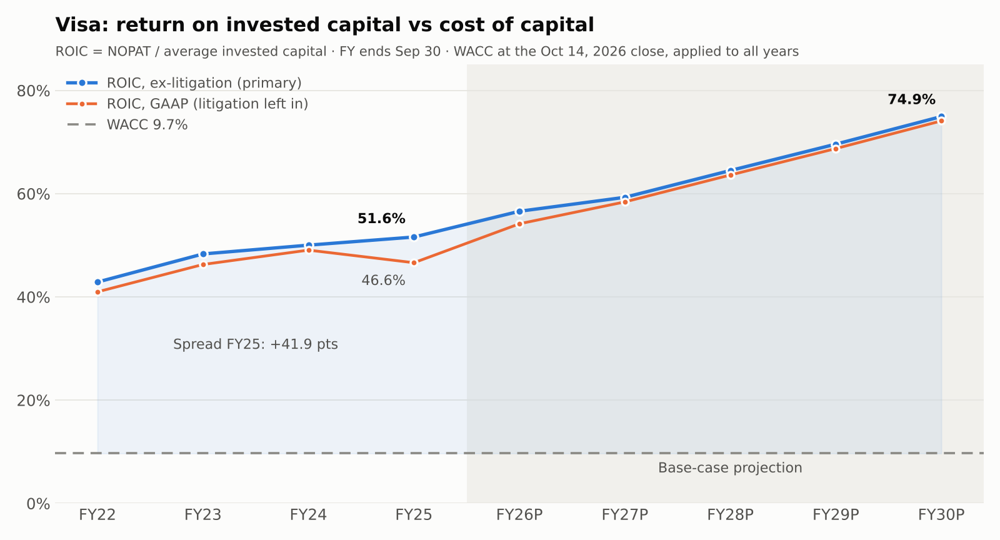

# Visa: The Digital Toll Road — ROIC vs WACC Analysis

A return-on-capital study of **Visa Inc. (NYSE: V)** built in Excel from Visa's SEC filings and company disclosures, testing whether Visa really behaves like a high-certainty "toll road" on global commerce. It covers a five-year audited history (FY21–FY25), a five-year base-case projection (FY26P–FY30P), and a like-for-like peer comparison against **Mastercard (NYSE: MA)**.

> **Thesis:** Visa earns a 37–42 point spread over its cost of capital (GAAP and ex-litigation) and grows with very little new capital. CapEx runs at 3–4% of revenue, and ~93% of free cash flow over FY21–FY25 went straight back to shareholders.

**Model:** [`Visa_Toll_Road_Model.xlsx`](Visa_Toll_Road_Model.xlsx) · **Read-only PDF of the ROIC/WACC and Mastercard tabs:** [`docs/Visa_ROIC_WACC_and_Mastercard_Peer.pdf`](docs/Visa_ROIC_WACC_and_Mastercard_Peer.pdf)

---

## Key findings (FY25, fiscal year ended Sep 30, 2025)

| Metric | Value |
|---|---|
| Net revenue | $40.0B (FY21–25 CAGR 13.5%) |
| Core take rate | 28.1 bps of payments volume (FY21: 23.2 bps) |
| Operating margin | 66.4% ex-litigation · 60.0% GAAP |
| **ROIC** (NOPAT / average invested capital) | **51.6% ex-litigation · 46.6% GAAP** |
| WACC | 9.7% |
| **ROIC – WACC spread** | **+41.9 pts ex-litigation · +36.9 pts GAAP** |
| Economic profit (ex-litigation) | $17.9B (81% of NOPAT) |
| Capital intensity (CapEx / revenue) | 3.7% |
| FCF returned to shareholders, FY21–25 | 93% (~78% via buybacks) |

### Five insights the model surfaces

1. **The operating leverage is in capital, not margins.** Excluding litigation, the degree of operating leverage is ~1.0x every year, so margins stay flat at 66–67%. Over FY21–25, 68% of incremental revenue became EBIT and 44% became FCF, while CapEx grew by only ~5 cents per incremental revenue dollar.
2. **Tangible invested capital is negative in every year** (FY25: –$4.4B). Strip out the Visa Europe goodwill and intangibles, and the network is funded by operating liabilities, not shareholders.
3. **Litigation is the main judgement call, so both views are shown.** Litigation provisions recur every year ($868M / $927M / $462M / $2,562M in FY22–25). The add-back rests on Visa's retrospective responsibility plan, under which escrow deposits for *U.S. covered* litigation dilute legacy class B holders. That mechanism does not cover every case. On GAAP figures, FY25 ROIC is 46.6% and the spread is still +36.9 pts, so the conclusion does not depend on the adjustment.
4. **Recent capital returns exceed FCF.** Visa returned 112% of FCF in FY24, 106% in FY25 and 134% in the first nine months of FY26, funded by cash and new debt. The base case assumes 120% for FY26P, then 95% from FY27P (the FY21–25 average was 93%). A minimum-cash check flags any scenario that would run cash below $5B.
5. **Mastercard's ROIC is ~2x Visa's (98% vs 52%), but Visa is the stronger engine.** The entire gap is acquisition goodwill and intangibles: $47.5B vs $15.1B, mostly from the 2016 Visa Europe deal. Debt-funded buybacks don't explain it, because they swap equity for debt and leave invested capital unchanged. Visa earns a 7-point higher margin and more absolute economic profit ($17.9B vs $14.1B), and the market prices both at ~35–37x earnings.

---

## Model structure

| Tab | Contents |
|---|---|
| **Tab1_Drivers** | Payments volume, transactions, revenue build (service, data processing, international, other, less client incentives), take rate, revenue yields |
| **Tab2_Core_Returns** | Income statement, GAAP vs ex-litigation EBIT, operating leverage, balance sheet, invested capital, FCF, FCF conversion, capital intensity, minimum-cash check |
| **Tab3_ROIC_WACC** | CAPM cost of equity, market cost of debt, WACC, ROIC (GAAP, ex-litigation, ex-goodwill), economic spread, economic profit, WACC and economic-profit sensitivity grids |
| **Tab4_Capital_Allocation** | Dividends, buybacks, payout ratio, dividend growth, share count, shareholder yield, FCF yield |
| **Tab5_Peer_Mastercard** | Mastercard rebuilt with identical definitions; FY25 head-to-head |
| **Data / Data_MA** | Every hardcoded input in one place, each with a source link |

**Conventions:** blue = hardcoded input · black = formula · green = link to another tab · yellow = assumption or third-party input · grey columns = projections. All hardcodes live on the Data tabs or in labelled assumption cells; everything else is a formula.

---

## Methodology

- **ROIC** = NOPAT / average invested capital, where NOPAT = EBIT × (1 – tax rate) and invested capital = total debt + equity – (cash + investment securities). The restricted litigation escrow is *not* treated as excess cash. FY21 tax is normalised to 17.0% (the GAAP rate of 23.4% includes a one-off ~$1.0B deferred-tax charge). The headline uses EBIT ex-litigation; GAAP ROIC is reported alongside it.
- **Operating ROIC** excludes goodwill only. Excluding intangibles as well makes the denominator negative, which is a finding in its own right.
- **WACC** (all market inputs at the Oct 14, 2026 close):
  - risk-free rate 5.19% (10-yr Treasury par yield)
  - Blume-adjusted beta 0.85
  - ERP 5.5% (conservative; Damodaran's implied ERP was 4.20% on Oct 1, 2026)
  - pre-tax cost of debt 5.42% (quoted yield on Visa's 4.15% 2035 notes)
  - market-value weights (~97% equity)
- **Take rate** = net revenue / payments volume. Visa recognises service revenue on the prior quarter's volume, so the ratio carries about one quarter of timing offset.
- **Projections (base case):** revenue is built bottom-up: volume × yield for service revenue, transactions × price for data processing, input growth rates for international and other revenue, and incentives as a % of gross. FY26P is calibrated to the nine months to Jun 30, 2026. The balance sheet rolls forward from cash flows.

## Base-case projections

| | FY25 | FY26P | FY30P |
|---|---|---|---|
| Net revenue | $40.0B | $45.6B | $66.4B |
| Take rate | 28.1 bps | 29.2 bps | 31.6 bps |
| Operating margin, ex-litigation | 66.4% | 66.0% | 66.8% |
| Net income | $20.1B | $24.1B | $36.2B |
| ROIC (ex-litigation / GAAP) | 51.6% / 46.6% | 56.6% / 54.2% | 74.9% / 74.1% |
| Economic profit | $17.9B | $21.0B | $32.0B |
| Dividend per share | $2.36 | $2.72 | $4.64 |

Projected ROIC rises because invested capital barely grows (acquisitions only, ~$0.8B a year) while NOPAT grows ~10% a year. Treat the outer years as an upper bound: share-based compensation and any larger acquisition would add capital.

---

## Validation

**Automated:** run `python scripts/audit_model.py Visa_Toll_Road_Model.xlsx`. The workbook needs cached values, i.e. last saved by Excel or LibreOffice. The script exits non-zero on any failure and checks:
- no error values (#DIV/0!, #REF!, #N/A, …) anywhere in the workbook
- colour convention: hardcodes blue, formulas never blue
- every projection row uses one consistent formula across FY26P–FY30P
- 34 key historical outputs (take rate, EBIT, FCF, invested capital, NOPAT, ROIC, shareholder yield) independently recomputed from the Data tab
- WACC recomputed by hand
- cash and invested-capital roll-forwards balance in every projected year

**Also built into the workbook:** historicals tie to the 10-K (revenue components, opex, operating income, pre-tax and net income reconcile to zero), plus the minimum-cash flag.

**Stress tests (run during development with LibreOffice recalculation; not part of the audit script):**

| Scenario | FY30P ROIC | FY30P economic profit |
|---|---|---|
| Base case | 74.9% | $32.0B |
| Zero payments-volume growth | 68.0% | $28.6B |
| Beta 1.3, ERP 8% (WACC 14.5%) | 74.9% | $29.7B |
| Opex at 40% of revenue | 67.6% | $28.3B |
| Investment securities not treated as cash | 70.8% | $31.8B |

These were run before the payments-volume source update in this version, which moved projected revenue by under 0.1%.

---

## Data sources

- Visa Form 10-K filings FY2021–FY2025 and Q4 earnings releases (SEC EDGAR), including stockholders' equity notes for as-converted share counts and dividend rates
- Visa Operational Performance Data, Q4 FY23 and Q4 FY25 (payments volume, 12 months ended Sep 30); FY21 is derived from the FY22 figure and Visa's reported +11.6% nominal growth
- Visa FY2025 Annual Report key statistics (processed transactions)
- Visa Q3 FY2026 Form 10-Q and earnings release (share count, debt, nine-month results)
- U.S. Treasury Daily Par Yield Curve (risk-free rate)
- Aswath Damodaran, implied equity risk premium (Damodaran Online)
- SEC free-writing prospectus for Visa's 4.15% notes due 2035 (terms); public bond quote (yield)
- Mastercard Form 10-K FY2025, Q4 earnings releases 2022–2025 and Q2 2026 Form 10-Q
- Yahoo Finance daily history (fiscal year-end closing prices, Oct 14, 2026 closes, betas)

## Limitations

- **Betas** (Visa 0.77, Mastercard 0.76) are third-party Yahoo figures; no primary source publishes beta. The sensitivity grid spans 0.59–1.10.
- **Cost of debt:** the bond quote is undated, and its implied ~23 bp spread over Treasuries is tight for AA- nine-year paper. With debt at ~3% of capital, +50 bp on the cost of debt moves WACC by only ~1 bp.
- **WACC** uses today's market inputs for every historical year. Rates were lower in FY21–22, so historical spreads are, if anything, understated.
- **FY26P year-end share price** is a model output (P/E × earnings) that sets the buyback share count. It will be replaced by the actual Sep 30, 2026 close with the FY26 update.
- **Mastercard's fiscal year** ends in December, three months later than Visa's (September).
- **Projections** ignore share-based compensation, so projected capital is slightly understated.

## Next update

Visa reports FY26 results in late October 2026 and files the 10-K in mid-November. FY26P will then be replaced with actuals.

---

*This is an independent educational analysis built from public filings. It is not investment advice.*
